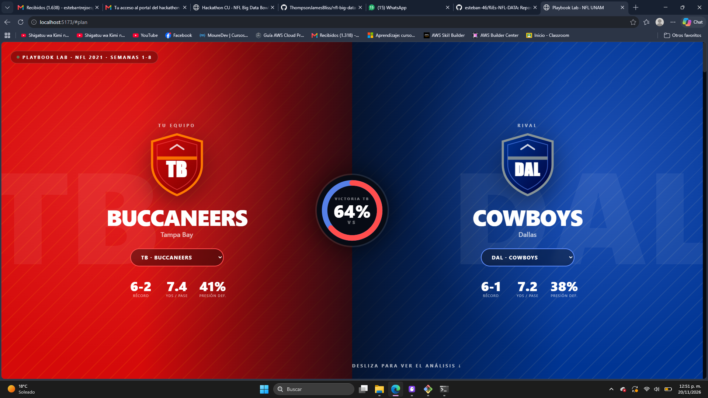
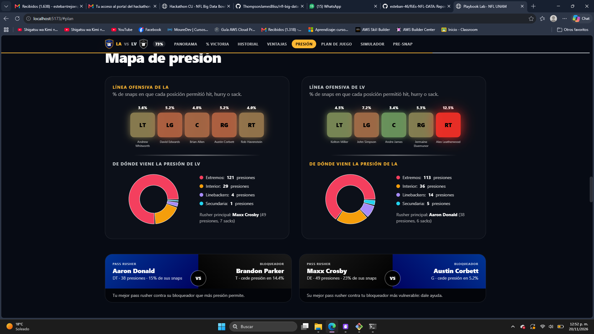
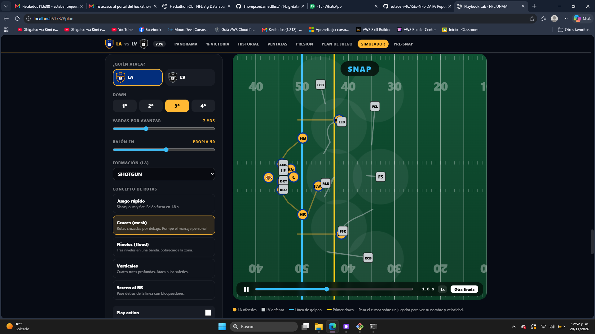

NFL Big Data Bowl  AWS UNAM

-Qué construimos: Un sitio web interactivo que analiza las 8,557 jugadas de pase de la NFL 2021 (semanas 1 a 8) con tres secciones: Versus entre dos equipos, un simulador animado de jugadas con velocidades y posiciones reales del tracking, y un lector pre-snap.

-Qué revela: La probabilidad de victoria de cada enfrentamiento y qué factores la explican, contra qué coberturas rinde mejor tu ofensiva, por qué posición de la línea entra la presión y qué cobertura o blitz esperar según el down, la distancia y los defensores en la caja.

-Quién lo usará:Entrenadores y coordinadores ofensivos y defensivos que preparan el plan de juego de la semana y quieren decidir sus jugadas con datos.

Versus. El entrenador elige su equipo y el rival, y cada mitad de la pantalla toma los colores de su equipo. Al centro aparece la probabilidad de victoria: Tampa Bay tiene 64% contra Dallas porque en este cruce su defensa genera más presión y su ofensiva produce más yardas por pase y más jugadas explosivas. Bajo cada equipo se ven su récord real, las yardas por pase y qué tanto presiona su defensa.

Mapa de presión. Cada bloque es una posición de la línea ofensiva y se pone más rojo mientras más presión permite. En este cruce, el tackle derecho de Las Vegas cede presión en el 12.5% de sus snaps, más del doble que el promedio del resto de su línea (5.1%). El plan recomienda alinear a Aaron Donald de ese lado. Abajo se comparan los duelos clave entre el mejor pass rusher de cada equipo y el bloqueador más débil del otro.

Simulador. El entrenador arma la jugada: quién ataca, down, distancia, formación y concepto de rutas. Los jugadores se alinean en sus posiciones promedio reales al momento del snap y corren a la velocidad máxima medida por el tracking. La defensa reacciona con la cobertura que el rival usa más en esa situación, y al final la app muestra la probabilidad de completar el pase, las yardas esperadas y qué concepto funciona mejor contra esa cobertura.
